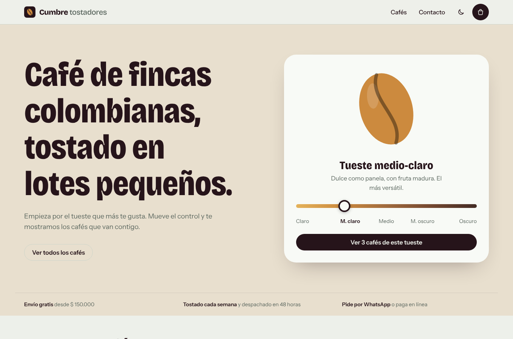
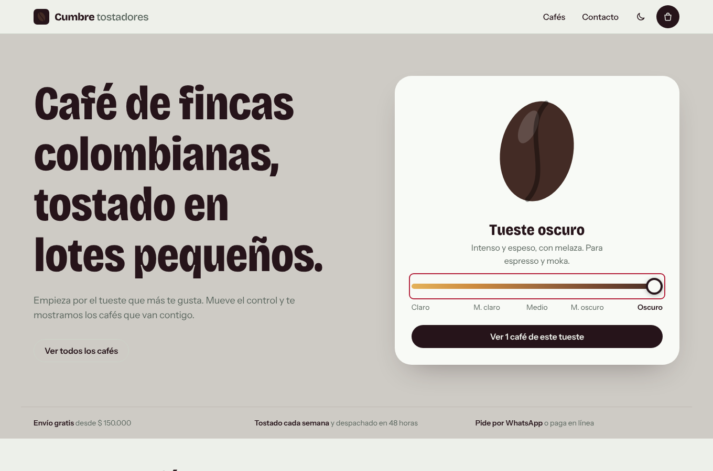
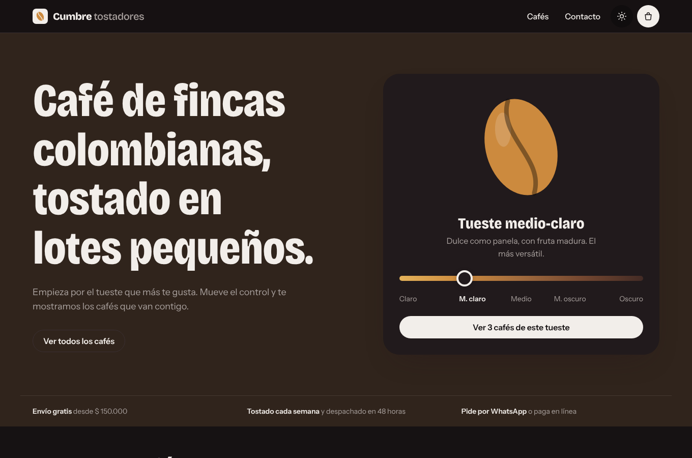
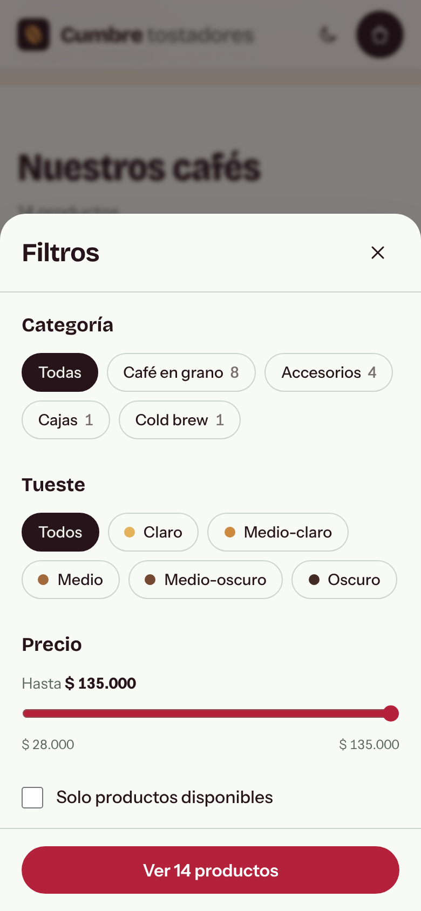

# Cumbre Tostadores: tienda con carrito, WhatsApp y pasarela de pago

Tienda en línea de café de especialidad colombiano. Cubre el flujo completo de un e-commerce pequeño: catálogo con filtros, carrito persistente, pedido por WhatsApp o pago en línea, y un panel para administrar productos y pedidos.

Es un proyecto de portafolio. La marca y los productos son ficticios, y los pagos funcionan en modo de prueba: no se cobra dinero real.



## Lo que lo hace distinto

**El selector de tueste.** La portada no empieza con una cuadrícula de productos, sino con una pregunta: ¿cómo te gusta el café? Al mover el control, el grano cambia de color, toda la página toma el tono del tueste y el botón te lleva al catálogo ya filtrado. Es una forma de buscar que tiene sentido para este negocio.

| Tueste oscuro | Modo oscuro | Móvil |
|---|---|---|
|  |  |  |

## Funciones

**Tienda**
- Catálogo con búsqueda, categoría, tueste, precio máximo, solo disponibles y orden. Los filtros viven en la URL: se pueden compartir y el botón "atrás" funciona.
- Detalle de producto con origen, altitud, notas de cata y productos relacionados.
- Carrito persistente en `localStorage`. Al volver a abrir la tienda se revisan precios y stock contra el servidor, y si algo cambió se avisa.
- Barra de progreso hacia el envío gratis dentro del carrito.
- Checkout con validación en línea, datos recordados para la próxima compra y dos formas de pago:
  - **WhatsApp:** guarda el pedido y arma el mensaje con el resumen, listo para enviar.
  - **En línea:** Mercado Pago (Checkout Pro). Sin credenciales usa una pasarela simulada para poder demostrar el flujo.
- Página de seguimiento del pedido con línea de tiempo, accesible solo con el enlace que recibe quien compra.

**Panel de administración** (`/admin`)
- Resumen con ventas, pedidos pendientes, stock bajo y lo más pedido.
- CRUD de productos con vista previa, subida de foto, color de la bolsa, stock editable en la tabla y visibilidad con un interruptor.
- Pedidos con cambio de estado, filtro y botón para escribirle al cliente por WhatsApp.

**Experiencia de usuario y accesibilidad**
- Esqueletos de carga, estados vacíos y de error que explican qué hacer.
- Cajón del carrito y filtros móviles con `<dialog>` nativo: foco atrapado, cierre con Esc y fondo inerte.
- Modo oscuro que respeta la preferencia del sistema y no parpadea al cargar.
- `prefers-reduced-motion`, enlace para saltar al contenido, foco visible, etiquetas en todos los campos y mensajes con `aria-live`.
- Probado sin desbordamiento horizontal desde 320 px hasta 768 px.

## Decisiones técnicas

- **El servidor nunca confía en el cliente.** El carrito envía solo `productId` y cantidad. Precios, envío y total se recalculan en el servidor dentro de una transacción que también valida y descuenta el stock.
- **Pedidos con token público.** Cada pedido tiene un token aleatorio, comparado con `timingSafeEqual`, para que el cliente vea su pedido sin crear cuenta y sin que nadie pueda adivinar enlaces.
- **Webhook que no confía en el cuerpo.** Cuando Mercado Pago avisa un pago, el servidor consulta el pago directamente a su API antes de marcar el pedido como pagado.
- **Cancelar devuelve el stock** y un pedido cancelado no se puede reactivar.
- **Validación con Zod** en todas las rutas, con mensajes en español que el formulario muestra junto a cada campo.
- **Seguridad básica:** Helmet, CORS acotado, límite de intentos en el login, contraseñas con bcrypt y JWT.
- **Sin base de datos externa:** SQLite integrado en Node (`node:sqlite`): no hay nada que compilar al instalar y el proyecto corre con un solo comando. Cambiarlo a Postgres es directo porque todo el acceso a datos está en `src/routes`.

## Tecnologías

React 19, Vite, Tailwind CSS 4, React Router. Node.js, Express 5, SQLite (`node:sqlite`), Zod, JWT. Tipografías Bricolage Grotesque e Instrument Sans.

## Cómo correrlo

Necesitas Node.js 22.13 o superior (incluye SQLite). Revísalo con `node -v`.

```bash
npm install       # instala las dependencias de la raíz, del servidor y del cliente
npm run dev       # API en :4000 y tienda en http://localhost:5173
```

Si prefieres instalar a mano: `npm --prefix server install` y `npm --prefix client install`.

En Windows, evita carpetas sincronizadas con OneDrive: `node_modules` tiene miles de archivos y la instalación se vuelve lenta. Mejor ubícalo en algo como `C:\proyectos\cafe-tienda`.

La primera vez se crea la base de datos con 14 productos de ejemplo. Panel en `/admin` con:

- Correo: `admin@cumbre.co`
- Contraseña: `admin1234`

Otros comandos: `npm test` (10 pruebas de integración de la API), `npm run seed` (reinicia el catálogo) y `npm run build` (compila el frontend).

### Configuración

Copia `server/.env.example` a `server/.env` y ajusta lo que necesites:

| Variable | Para qué sirve |
|---|---|
| `STORE_WHATSAPP` | Número de la tienda con indicativo y sin `+` (Colombia: `57...`). **Cámbialo por el tuyo** para que el botón funcione en tu demo. |
| `ADMIN_EMAIL`, `ADMIN_PASSWORD` | Usuario del panel. |
| `JWT_SECRET` | Obligatorio cambiarlo en producción: `openssl rand -hex 32`. |
| `FREE_SHIPPING_FROM`, `SHIPPING_FLAT` | Umbral de envío gratis y costo del envío. |
| `MP_ACCESS_TOKEN` | Credencial de Mercado Pago. Vacío = pasarela simulada. |

### Mercado Pago de verdad

1. Crea una aplicación en el [panel de desarrolladores de Mercado Pago](https://www.mercadopago.com.co/developers) y copia el *Access Token* de pruebas (empieza con `TEST-`).
2. Ponlo en `MP_ACCESS_TOKEN` y reinicia la API.
3. Para recibir la confirmación del pago, la API debe ser accesible desde internet: define `PUBLIC_API_URL` con su dirección pública (en local sirve un túnel como ngrok).

> **Nota:** el flujo con credenciales reales sigue la documentación de Checkout Pro, pero en este repositorio solo se verificó automáticamente el modo simulado. Pruébalo con tus credenciales de prueba antes de mostrarlo.

## Despliegue

- **Todo en un servicio:** `npm run build` y luego `npm start`. El servidor entrega el frontend compilado desde `client/dist`. Sirve en Render, Railway o Fly.io.
- **Separado:** frontend en Vercel o Netlify (con `VITE_API_URL` apuntando a la API) y la API en Render o Railway. Pon la URL del frontend en `CLIENT_URL`.
- SQLite guarda su archivo en `server/data/`. En plataformas con disco efímero, monta un volumen o migra a Postgres (Neon, Supabase).
- Antes de publicar la demo, decide si quieres mostrar la cuenta de prueba en el login (`VITE_SHOW_DEMO_LOGIN`).

## Ideas para seguir

- Paginación o scroll infinito si el catálogo crece.
- Correo de confirmación al cliente (Resend o Nodemailer).
- Cupones de descuento y suscripción mensual de café.
- Migrar a Postgres con Prisma.
- Pruebas end-to-end con Playwright.
